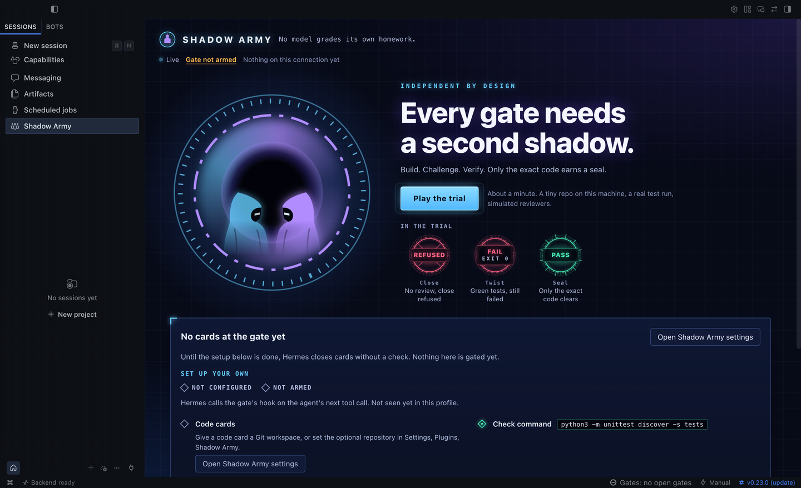

# Shadow Army

No model grades its own homework.

Shadow Army is a Hermes Agent plugin. Once armed, the agent cannot close a Kanban code card until a verifier from a different model family has run the owner's check on the exact code. The plugin and its guide are in [shadow-army](shadow-army/README.md).

The `test_*.py` files, `host_probe.py` and `verify_archive.py` test the plugin. [shadow-army/VERIFICATION.md](shadow-army/VERIFICATION.md) gives the commands. [docs/demo.md](docs/demo.md) is the demo shot list.

**Demo film (51 seconds):** [docs/demo.mp4](docs/demo.mp4). In it the plugin and its checks are real; the two models in the built-in trial are simulated.

**Install:** `hermes plugins install SilentKnight87/shadow-army#shadow-army --enable`

MIT licensed. See [LICENSE](LICENSE) and [NOTICE.md](NOTICE.md).
