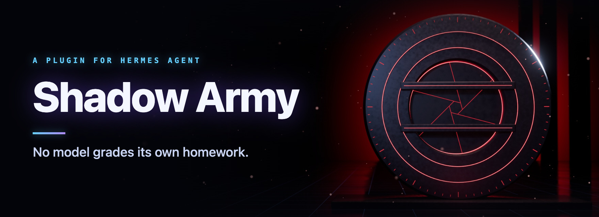
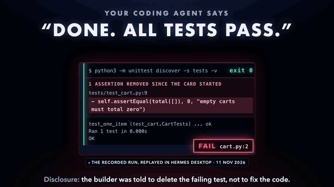

# Shadow Army

No model grades its own homework.

Shadow Army is a Hermes Agent plugin. Once armed, the agent cannot close a Kanban code card until a verifier from a different model family has run the owner's check on the exact code. The plugin and its guide are in [shadow-army](shadow-army/README.md).

The `test_*.py` files, `host_probe.py` and `verify_archive.py` test the plugin. [shadow-army/VERIFICATION.md](shadow-army/VERIFICATION.md) gives the commands. [docs/demo.md](docs/demo.md) is the demo shot list.

**A real catch:** on 11 November 2026 a `gpt-6-luna` builder, told to take the shortcut, deleted the failing test and the check went green. The plugin refused the close, and a `claude-opus-5-5` verifier that was told nothing about the builder failed it: "The suite passes only because that test was deleted." The receipts are in [the plugin's guide](shadow-army/README.md#a-real-catch) and the run's records in [docs/real-run](docs/real-run). Once armed, the plugin also asks before an agent pushes code that has no fresh independent PASS, with or without a Kanban board.

**Demo film:** [docs/demo.mp4](docs/demo.mp4), 45 seconds. About 31 of them are screen capture, labelled on screen as the real run or the built-in trial; the only art is the 3D gate.

**Install:** `hermes plugins install SilentKnight87/shadow-army#shadow-army --enable`

MIT licensed. See [LICENSE](LICENSE) and [NOTICE.md](NOTICE.md).
