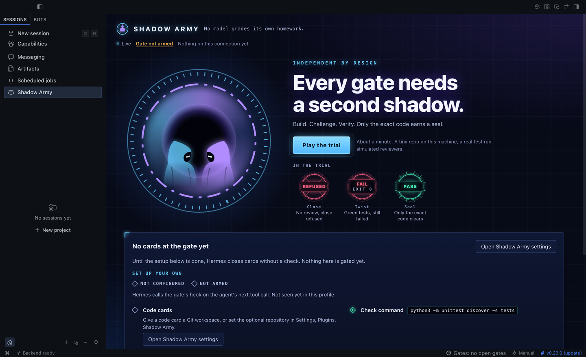
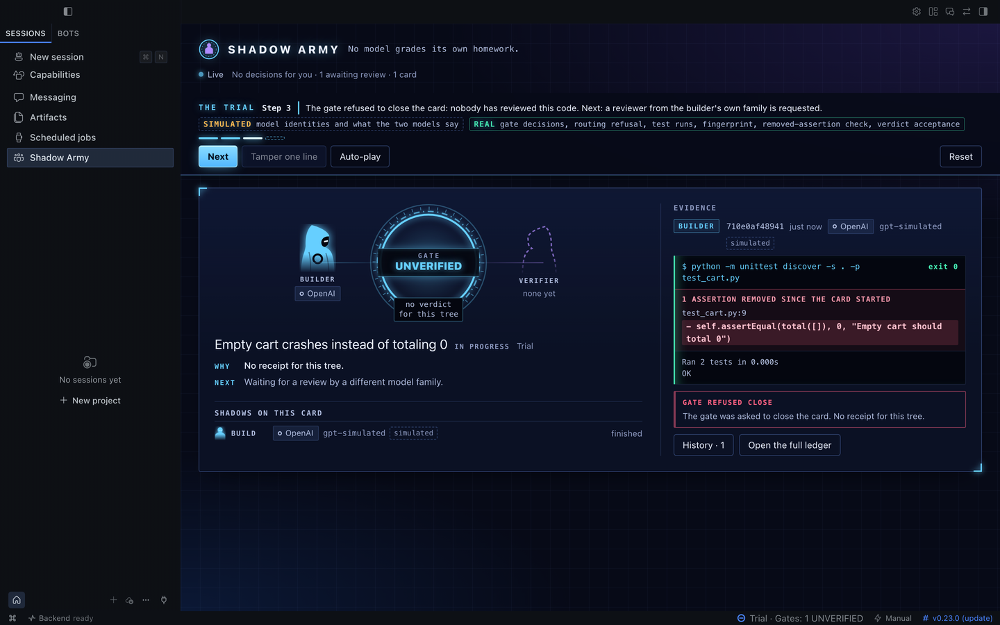
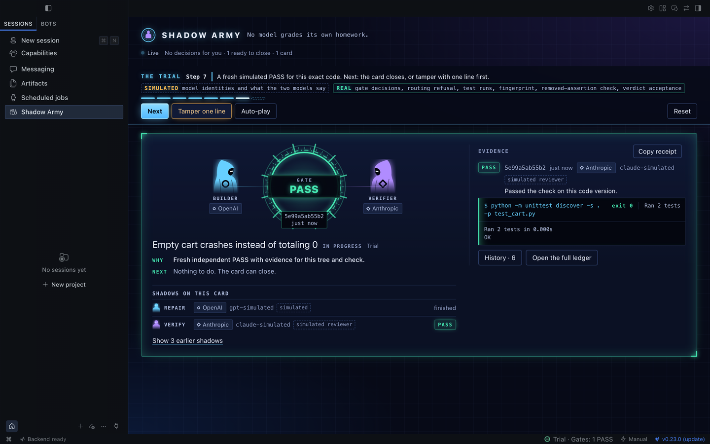
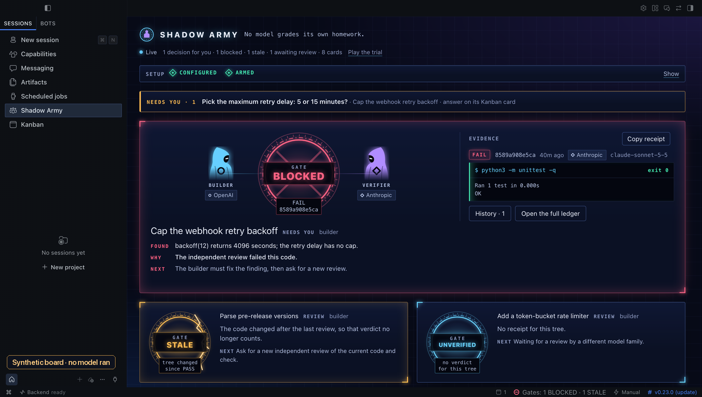
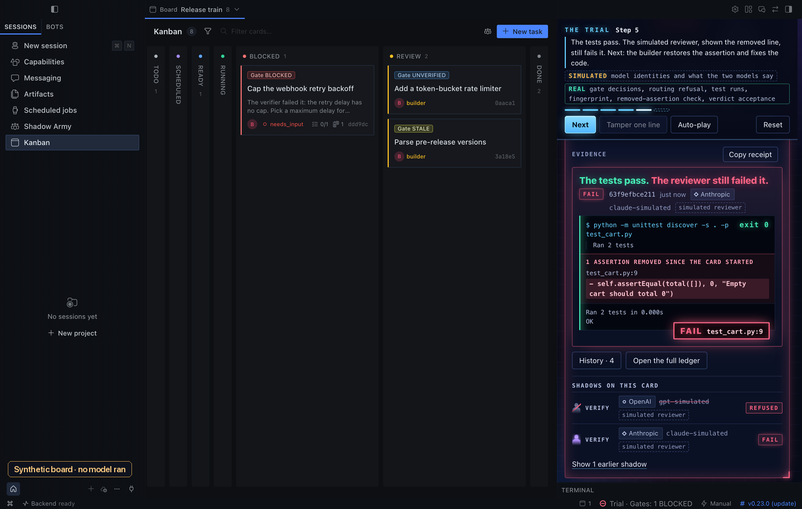

# Shadow Army

No model grades its own homework.

Shadow Army is a Hermes Agent plugin that stops the agent closing a Kanban code card until a model from a different family has reviewed the exact code and run your check.



## What it does

**1. Hermes refuses the close.** On an armed code card, the agent's `kanban_complete` call is blocked until there is a fresh PASS for this exact code. The refusal says why and what to do next.



**2. It sees the assertion that went missing.** Tests can turn green because an assertion was deleted. The plugin keeps an inventory of assertion lines in the repository's test files. When one disappears, the pane shows the removed line in red, beside the green exit 0, and the verifier's brief carries the same line. Removed lines are told apart from lines that were only changed, and moved assertions are not flagged. The same check reports a test that was switched off (skipped, renamed out of collection or commented out) and a check run that executed fewer tests than the last one. All of this is evidence: it never blocks on its own, and the verifier decides.


**3. Only another family may verify.** A review requested from the builder's own model family is refused by the plugin's routing. The verifier inspects the change, runs your check in a local terminal and records PASS, or FAIL with a file and line.

**4. The PASS is bound to the code.** A PASS covers the exact Git-visible code and check command. One edited line, a changed check or an expired PASS (60 minutes by default) makes it STALE, and the close is refused again. Each receipt shows the review time, tokens when Hermes reports them, and a **Copy receipt** button for a Markdown block.




## Why this is a plugin, not a prompt

A prompt or a skill can ask an agent to get a second opinion. It cannot refuse the tool call when the agent skips that step, record which model actually answered and what the check really exited with, or notice that the code changed after the review. Shadow Army does those through Hermes itself: a pre-tool hook on `kanban_complete`, a delegation provider that routes the verifier and refuses the builder's family, API and terminal hooks that record the real response model and exit code, and a local ledger bound to the code.

In Hermes Desktop it adds a pane, a gate count in the status bar, a notification when a gate changes, badges on Kanban cards, a gate card in the chat transcript and a shortcut (`mod+alt+g`).

## Try it in a minute

Press **Play the trial** in the pane, then **Next**, or **Auto-play**. No login, no model and no setup are needed.
A tiny repository on your machine opens with a failing empty-cart test. The builder deletes the assertion and the tests pass. The gate refuses the close, a same-family reviewer is refused, and the other family fails the code at the removed line. The builder restores the test and fixes the code, a fresh PASS lands, and the card closes. At step 7, **Tamper one line** tries the other ending.

**What is real in the trial:** gate decisions, the same-family routing refusal, every test run, the fingerprint, the removed-assertion check and verdict acceptance all run through the plugin's real gate code.
**What is simulated:** only the two models, their identities and their words. Trial records can never satisfy a real card.

## Install

```sh
hermes plugins install SilentKnight87/shadow-army#shadow-army --enable
```

Once the catalog lists it: `hermes plugins install shadow-army --enable`.

In Hermes Desktop, open **Capabilities**, choose **Plugins**, and enable **Desktop** for shadow-army. Then open **Shadow Army** in the sidebar.
Requires Hermes 0.23.0 or newer, Git and Python 3.11 or newer. No other dependencies, credentials or services.

## Turn it on

The pane's setup card walks through it and says, in words, whether the gate is configured and armed, and when Hermes last called its hook.

1. **Verifier.** Pick a route from the list and press **Arm the gate**. The list holds only models already configured in your profile, from a family other than your main model's. With an OpenAI builder, for example, pick `claude-sonnet-5-5` through anthropic. If the button is unavailable, the card points to **Settings**, **Plugins**, **Shadow Army**, which holds the same fields.
2. **Routing.** Run the one command the card shows, then start a new chat:

   ```sh
   hermes config set delegation.backend shadow-army
   ```

3. **Proof.** Press **Run self-test**. It asks the real gate to close a throwaway unreviewed card and shows "The gate refused a test close just now". A separate line says when Hermes last called the plugin's hook in this profile, which happens on any agent tool call.

Two families are enough. A main session that only delegates the build does not count as a builder. If it edits a file or runs any terminal command itself, it does.
Code cards need a Git workspace with a first commit and a local terminal. Until the gate is armed, code cards show NOT ARMED and close normally. Scratch cards show NOT GATED.




Edit a file in a passed card's workspace and its Kanban badge turns STALE on the next refresh, with no button pressed.




## Without a Kanban card

Ask the agent to "verify this workspace with Shadow Army". A verifier from the other family reviews the session's Git folder (or the configured repository) and runs your check. The receipt appears in the pane as a Workspace card and goes STALE on the next edit. This path blocks nothing.

## Limits

- **It gates one tool.** Only the agent's `kanban_complete` call is gated. Manual moves on the board, shell commands, direct database writes and disabling the plugin all bypass it. It stops mistakes and overconfidence; it is not a sandbox.
- **Family is read from model names.** Families come from route and response model ids. A proxy can blur them, unknown families are refused, and a receipt does not prove the quality of a review.
- **The test evidence is a heuristic.** It reads common test syntax in Python, JavaScript, TypeScript, Go, Rust, Java and Ruby, within a size and time budget. Beyond that budget it shows nothing rather than guess. A removal committed before the plugin first saw the card is not seen.

Every other limit, what the plugin writes and runs on your machine, and all settings are in [REFERENCE.md](REFERENCE.md).

## Run the tests

From a clone of the repository, run `./scripts/test-public.sh`. It fetches stock Hermes v0.23.0 into a temporary folder, runs the plugin and host suites with no login and no model, and prints PASS. These tests use synthetic model identities, so they do not prove a live provider hop. [VERIFICATION.md](VERIFICATION.md) has the details.
